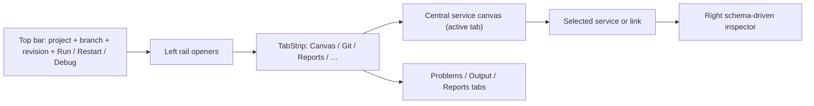

# Config workspace

## 1. Shell

Config workspace — основной canvas-first экран Studio. Он показывает runtime
services и связи между ними, а не live-подключение к Core.

Config workspace — это вкладка `Canvas` внутри tabbed shell (см.
[UI system](ui-system)), а не отдельный экран.

Зоны:

- top bar — project, branch, commit/revision и Run/Restart/Debug для всех сервисов проекта;
- left rail — Canvas, Git, Reports, Plugins, Problems, Output; ПКМ даёт действие добавления плагина;
- Settings — локальный каталог версий Studio-плагинов и сервисных бинарников, Docker Engine и Core;
- отдельного File Manager и Core-backed runtime страницы нет;
- TabStrip — активная вкладка canvas и остальные workbench-вкладки;
- canvas — service nodes и links;
- inspector — выбранный node/link;
- `problems`, `output`, `reports` — обычные вкладки; нижнего dock нет.

По умолчанию активна вкладка Canvas. Inspector открывается при выборе объекта.

## 2. Страницы

### Start / Projects

Показывает открытые projects, repository status и последние CLI/CI reports.

### Project workspace

Показывает file tree, project metadata, validation и drafts.

### Config workspace

Показывает canvas runtime service instances, service-to-service links и
schema-driven inspector.

### Services

Показывает inventory runtime services в таблице с фильтрами и переходом в canvas.

### Deploy reports

Показывает импортированные CLI/CI reports, operations, ACKs, errors и degraded
states. Live Core access из Studio отсутствует.

### Installed Studio plugins

Показывает только локально импортированные Studio plugins, trust decisions,
installed tools, updates из нового local package и rollback.

### Settings

Глобальная полноэкранная страница Studio (не вкладка): Editor / Appearance /
Language / Toolchain & CLI / Local Core. Project preferences и layout задаются
schema-driven полями Inspector, Studio plugin permissions — через trust dialog.
Core endpoint, credentials и transport остаются CLI-owned. Для смены локального
Core binary Studio даёт typed flow: native file picker → CLI ELF/digest inspect →
explicit exact-digest confirmation → единая typed CLI операция `core binary update`.
CLI запускает кандидат и фиксирует target registry только после readiness; при
ошибке старый binary остаётся выбранным, хотя Core может быть остановлен.
Renderer не получает доступ к target registry или секретам. Core DB, credentials,
certificates и service containers не заменяются. SQLite migrations автоматически
не откатываются.

## 3. Canvas

На canvas отображаются только:

- runtime service instances из Project;
- полные versioned service-to-service link contracts;
- schema/validation badges;
- last known deploy report indicators;
- project binding markers;
- selection и focus.

Сам Core, Core database, live replicas, credentials и service internals на canvas
не рисуются.

### Runtime service node

Минимум:

- display name;
- stable service id;
- type/manifest version;
- local validation state;
- last known deploy state;
- problem badge;
- project binding.

Click выбирает node и открывает inspector. Double-click переводит фокус в
settings section inspector.

### Link

Link создаётся drag-жестом между двумя runtime service nodes. Inspector
редактирует полный versioned contract (не только читает его) через typed
`UpdateServiceLink` и показывает:

- caller;
- target;
- link id;
- methods и enabled/disabled methods;
- request/response schemas;
- transport и security profile;
- timeout/retry/limits и redaction policy;
- validation state;
- generic contract/transport metadata, если оно доступно Core.

Product-specific UI не встраивается в общий renderer: service-owned schemas
рендерятся generic host-controlled controls. Raw secrets в link contract не
редактируются — только `secret-ref`.

### Layout

Положение node — локальное представление Studio, а не автоматически Core-owned
configuration. Доступны move, multi-select, zoom/pan, fit to content, focus from
tree/search и reset local layout.

## 4. Runtime service inspector

Inspector — schema-driven property editor с collapsible-секциями:

1. **Identity / Info** — read-only: id, name, service и manifest version,
   source;
2. **Settings** — schema-generated fields из Project JSON Schema
   (`readProjectSchema`, draft 2020-12); до использования live UI hints Studio
   последовательно читает manifest и schema через typed CLI → Core и сравнивает
   schema структурно. При drift редактирование и Core apply блокируются, draft
   сохраняется; offline draft можно записать только в Project и явно
   перепроверить позже;
3. **Link contract** — полное редактирование link-полей (см. §5);
4. **Source binding** — project file/module references;
5. **Last deploy** — commit, bundle digest, report state (redacted);
6. **Context** — project, Git revision/branch и безопасные actor/timestamps;
7. **Actions** — Run / Restart / Logs / Inspect (typed CLI intents, ephemeral
   status; при недоступности CLI/Core — `unknown`).

Поддерживаемые UX-типы полей: `string`, `number`, `boolean`, `select`,
`multiselect`, `duration`, `size`, `file`, `dir`, `array`, `object` и
`secret-ref`. Секреты отдаются только redacted; raw secret values не ходят во
frontend.

Неизвестный тип поля помечает секцию `unavailable` (fail-closed), а не
превращается в произвольный HTML control. Перед записью host повторно проверяет
тип/required/enum/bounds/pattern constraints и вложенные значения; renderer не
является security boundary сам по себе.

## 5. Link inspector

Link contract редактируется полностью, а не только отображается:

- caller и target;
- link id;
- contract/schema version;
- eligibility and validation;
- contract compatibility;
- methods и disabledMethods;
- request/response schemas и schema paths;
- transport/profile, securityProfile и limits;
- timeout/retry policy;
- redaction policy;
- last deploy report.

Запись проходит только через typed `UpdateServiceLink` в
`internal/domain/interfaces/project.go` (`GraphRepository`), реализацию с
валидацией и atomic write в `internal/infrastructure/project/mutations.go` и
binding в `internal/presentation/wails/app.go`. Общий inspector не знает
product-specific методы и payloads.

## 6. Runtime services workspace

Таблица runtime services должна показывать:

- service id/name;
- manifest/schema version;
- local validation;
- last known deploy generation;
- last report state;
- local project binding.

Таблица и canvas используют один project config read model и не создают второй
источник истины. Runtime observations принадлежат Core и доступны только в CLI
reports.
