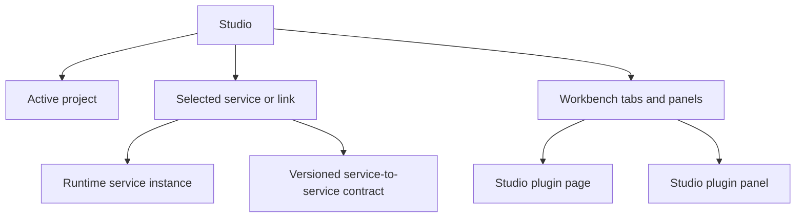

# Продуктовая модель Studio

## 1. Роль Studio

Studio находится между IDE и configuration workbench:

- как Android Studio — имеет project, manifest, file tree (открытие файлов в внешнем редакторе);
- как Unity — показывает объектную сцену runtime services и inspector выбранного объекта;
- как Figma — использует canvas-first tabbed workspace.

Core не рисуется отдельным узлом. Studio не является control-plane client и не
подключается к Core. Canvas показывает runtime service instances из project
source и links между ними, а результат deploy приходит только через CLI report.

## 2. Термины

### Core

Единичный runtime control plane, который хранит применённую desired
configuration в SQLite, публикует immutable generations и наблюдает replicas,
leases, readiness и rollout. Core доступен CLI, но не Studio.

### Runtime service declaration

Проектная декларация runtime service с reference на уже собранный внешний
binary artifact. Studio и CLI не компилируют service; CLI проверяет и подготавливает
зарегистрированный бинарник для локального runtime. В Studio декларация
представлена canvas node и правым schema-driven inspector. Runtime observations
отображаются только из Core-backed CLI response или импортированного CLI/CI report.

Runtime service не загружает в Studio исполняемый код. Product-specific fields
приходят через service-owned declarative settings schema.

### Studio plugin

Расширение самой Studio. Оно отделено от Core services и может объявлять
commands, workbench pages/panels, file associations, companion console tools
и capability access. UI pages/panels открываются как workspace tabs без
docking. Companion tool устанавливается и запускается через Studio
Tool Registry, но остаётся локальным developer tool, а не Core service.

### Project

Локальная source-структура Studio с root-папкой, manifest и деревом файлов.
Project не является копией Core SQLite и не заменяет Core как runtime source of
truth.

## 3. Три независимых контекста

Правила разделения:

- изменения исходников и их история управляются внешними инструментами;
- CLI report не переписывает source files;
- Studio plugin не получает Core credentials;
- удаление локального файла не удаляет Core generation.

## 4. Три состояния конфигурации

| Состояние | Владелец | Что означает |
| --- | --- | --- |
| Local source | Project files | Что оператор редактирует |
| Commit-backed bundle | CLI run | Что будет передано выбранному target |
| Applied/observed state | Core SQLite и CLI report | Что Core принял и что replicas подтвердили |

Studio должна визуально различать эти состояния. Нельзя показывать local draft
как applied generation.

## 5. Общий lifecycle изменения

Проект можно открыть и валидировать без Core. Для deploy нужны:

- выбранный CLI target;
- валидный manifest;
- валидные schemas и references;
- revision, требуемая CLI для выбранного target;
- remote approval, если target policy этого требует.

## 6. Ownership

| Объект | Владелец | Studio делает |
| --- | --- | --- |
| Core desired configuration | Core SQLite + CLI | Показывает provenance из CLI report |
| Replica/lease observations | Core/SDK + CLI report | Импортирует и фильтрует report |
| Project files | Project workspace | Индексирует, валидирует, редактирует через подходящий surface |
| Runtime service settings schema | Runtime service contract | Строит inspector |
| Studio plugin extension manifest | Studio plugin ecosystem | Регистрирует commands/pages/panels/editors/tools |
| Companion console tool | Studio plugin publisher | Устанавливает проверенный executable через Tool Registry |
| Local Studio plugin package | Plugin publisher + local user trust | Проверяет digest/manifest и управляет lifecycle |

## 7. Что не входит в базовую Studio

- Core API adapter и process supervisor для Core services;
- прямой Docker Engine API и управление удалёнными Swarm/Kubernetes-кластерами
  (локальная Docker-отладка запускается typed-командами CLI);
- Core credentials в frontend;
- product-specific routing editor общего назначения;
- автоматический replay неизвестной операции;
- raw JSON как основной операторский workflow; UI-поверхности Studio-плагинов загружаются только через sandboxed iframe-вкладки.
