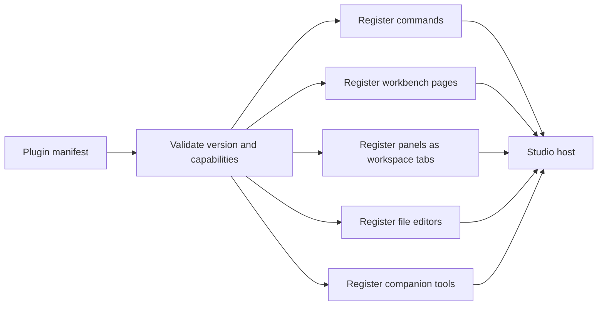
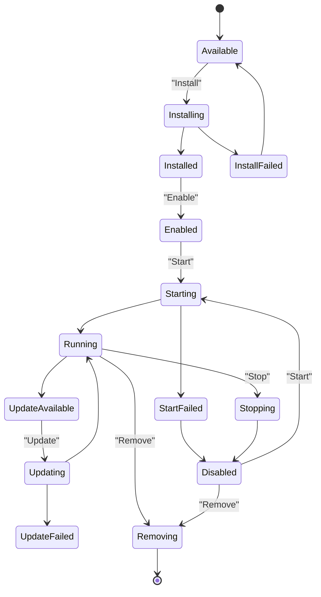
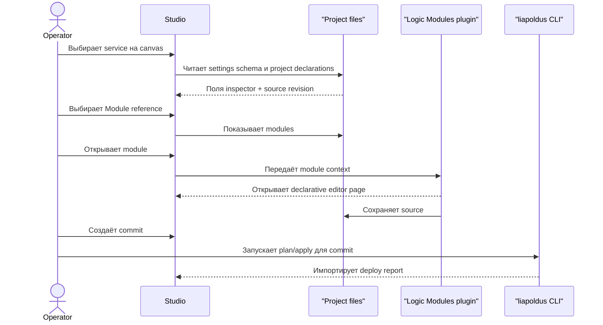

# Studio plugins и marketplace

## Размещение исходников в Liapoldus workspace

Активные исходники расширений Studio находятся в корневом каталоге `plugins/`.
Server editor принадлежит `plugins/studio-server/` и собирается в отдельный
`.studio-plugin`. Runtime Server и его product contracts принадлежат
`services/server/`; не помещать туда UI расширения и не перемещать туда
исполняемый StudioPlugin. Замороженные runtime-service snapshots
`services/captcha/` и `services/identity/` не переименовываются и не изменяются
этой работой.

Пакет `plugins/studio-server/` не является самостоятельным источником
конфигурационной схемы. Он потребляет Server-owned schema/UI metadata через
версионированный host API Studio. Текущий `studio-service-editor/v2` bridge
предоставляет redacted settings read, безопасный Core-backed
`service.configuration-ui.read` и `service.peer.catalog.read`, разрешённые
resource catalogs, safe shared draft и Project save через host; это не
применяет конфигурацию к Core. Peer catalog возвращает только bounded Project
service IDs/names/versions либо capability IDs/versions из manifest, полученного
Studio → typed CLI → Core. Endpoints, raw manifests и credentials в iframe не
передаются. Manifest/UI descriptor проходит только Studio → typed CLI → Core;
iframe не получает CLI, Core или Service SDK client.
Прямой доступ к Wails, Core Management API и Service SDK REST запрещён. Полный
bridge security corpus и UI acceptance пока не пройдены. См. [целевой план
конфигуратора](./plan#7-studio-plugin-sdk--server-extension).

Service runtime может объявить `editorButtons` версии
`service-editor-buttons/v1` в Core-backed manifest. Это декларативный список
stable IDs вида `<service-id>.<key>` с локализованными RU/EN label/description;
он не содержит кода или callback. В глобальных настройках Studio кнопки
назначаются на страницы установленных plugin packages. Назначения хранятся
глобально и не удаляются, если кнопка временно отсутствует в открытом Project.

Plugin page задаёт `context: workspace|service`. Workspace surface открывается
из левого rail. Service surface открывается кнопкой назначенного сервиса в
Inspector, с точным Project/service context; она скрыта в левом rail. При
отсутствии назначенного установленного плагина кнопка не показывается.

Server StudioPlugin использует live `service-configuration-ui/v1` descriptor:
показывает локализованные группы/описания и соблюдает SDK-порядок controls в
listener settings и специализированном endpoint/request editor во вкладке
Server Editor. Inspector содержит только кнопку запуска редактора, а не
редактирование endpoints. Descriptor
только дополняет Server-owned JSON Schema и не становится локальной копией
контракта; неизвестные или недоступные metadata не ослабляют schema validation.

## 1. Две разные модели

| | Core services | Studio plugins |
| --- | --- | --- |
| Назначение | Runtime/control-plane services | Расширения Studio |
| Представление | Canvas node + inspector | Commands, pages, panels |
| Lifecycle | Core наблюдает и применяет settings | Local package import/start/update |
| Settings UI | Schema-driven inspector | Declarative surfaces + sandboxed iframe UI-surface |
| Process control | Не управляется Studio | Отдельный plugin lifecycle |
| Локальные инструменты | Не являются частью Core service | Companion console tools, принадлежащие plugin |
| Ошибка | Degraded service/replica | Plugin unavailable/disconnected |

Нельзя показывать Core service как Studio plugin marketplace item.

## 2. Extension manifest

Studio plugin должен объявлять:

- identity;
- version;
- required Studio range;
- commands;
- pages;
- panels;
- file types/editors;
- UI-surfaces (declarative и sandboxed iframe);
- companion console tools;
- capability requirements;
- permissions explanation;
- lifecycle metadata.

Точный wire schema должен быть утверждён отдельным владельцем. В Studio этот
manifest используется для безопасной регистрации extension points.

> Граница: декларативные UI-surfaces принадлежат StudioPlugin, а их manifest,
> sandbox и typed host bridge — контракту Studio Plugin SDK, который владеет
> репозиторий `studio/`. Service SDK и Wool не участвуют в загрузке или
> выполнении расширений редактора. В текущей реализации route хранится в
> `StudioPluginSurface.Route` (`internal/domain/models/plugin.go`); versioned
> bridge и правила совместимости описаны в этой документации и `AGENTS.md`.

## 3. Extension host



Studio рендерит объявленные declarative surfaces собственными компонентами.
Произвольный HTML/CSS/remote JavaScript не должен автоматически попадать в Core
inspector. В desktop host установленный surface schema читается только через
`ReadStudioPluginSurface`: путь проверяется относительно package root, symlink
запрещены, содержимое должно быть valid JSON. Renderer получает
`surface + schema` и строит host-controlled preview из generic controls; plugin
HTML/JS в основной renderer не загружается.

### Declarative surfaces

Declarative surface (`kind: "command"` и schema-bound preview) остаётся
host-controlled: Studio строит UI из generic controls по JSON Schema. Здесь
plugin HTML/JS не исполняется.

### UI-surface (sandboxed iframe)

UI-surface — вторая форма surface, при которой plugin поставляет HTML/JS/CSS и
Studio исполняет его в изолированном `<iframe sandbox="allow-scripts">`. Это
разрешено для UI **любого установленного Studio-плагина** (не только
подписанного). Workspace surface запускается из левого rail, service surface —
кнопкой сервиса в Inspector после назначения в настройках плагина. Контракт
границы:

- только `<iframe sandbox="allow-scripts">`; `allow-same-origin`,
  `allow-popups`, forms и любые дополнительные sandbox-токены не добавляются;
- без `allow-same-origin` frame получает opaque origin: нет доступа к DOM host,
  cookies, storage, same-origin ресурсам Studio;
- нет доступа к Wails bindings, файловой системе и Node;
- обмен host↔frame — только через `postMessage` bridge; raw credentials и
  secrets по bridge не ходят;
- `MessageEvent.origin` определяется отправителем: сообщения plugin iframe →
  host приходят с opaque origin `null`, а host → plugin — с origin окна Studio.
  Host проверяет `event.source === iframe.contentWindow` и `origin === "null"`;
  plugin проверяет `event.source === parent`, закрепляет origin после строгого
  versioned handshake и проверяет его для последующих ответов. Нельзя
  симметрично требовать `origin === "null"` с обеих сторон;
- для Server editor разрешены только typed intents `context.get`,
  `service.settings.read`, `service.configuration-ui.read`,
  `service.peer.catalog.read`, `service.resource.list`,
  `service.admin-surface.read`, `service.resource.artifact.select`,
  `service.resource.publish`, `service.resource.operation.watch`,
  `service.settings.patch` и `service.settings.save`; settings read/write,
  SDK UI metadata, peer catalog, resource catalog и Admin Surface требуют
  declared + granted permissions. Admin Surface приходит из Core через typed
  `liapoldus service admin-surface inspect`; StudioPlugin не получает SDK URL,
  endpoint или credentials. Artifact publication требует отдельного
  `service.resources.publish`: native host выбирает только Project-файл,
  повторно валидирует live action descriptor и требует системное подтверждение.
  `service.resource.operation.watch` использует то же permission и доступен
  только для operation ID, созданного этим host для выбранных Project/service;
  состояние и безопасный failure code читаются через typed CLI → Core. Одно
  permission не наследует другое;
- host применяет строгий CSP `frame-src`, разрешающий только ассеты плагина;
- ассеты плагина отдаются Wails `AssetServer` по path-confined маршруту из
  installed package root (новое поведение: HTML/JS никогда ранее не отдавались
  через Go-host); symlink и выход за пределы package root запрещены;
- runtime (Core) plugin executables по-прежнему не загружаются, trust/digest/
  atomic activation и permissions/grants сохраняются.

UI-surface — единственная поверхность, где исполняется plugin HTML/JS; поэтому
sandbox обязателен всегда и не конфигурируется в более слабую сторону.

## 4. Companion console tools

Companion console tool — локальный исполняемый инструмент, который поставляется
в составе Studio plugin и регистрируется в Studio под стабильным логическим
`toolId`. Это расширение developer workflow, а не Core service и не замена
standalone `liapoldus` CLI.

Например, Studio plugin для Runtime может поставлять `runtime.wasm-compiler`:
компилятор, который собирает исходник модуля в WASM и возвращает diagnostics и
build artifacts. Это companion tool Studio plugin, а не бинарник Core Runtime
plugin. Пользователь устанавливает Studio plugin один раз, после чего Studio
знает, какая версия компилятора совместима с его редактором и может запускать
её из command, page или file editor.

### Границы ответственности

| Объект | Владелец | Что делает Studio |
| --- | --- | --- |
| Studio plugin | Marketplace и publisher plugin | Регистрирует surfaces, permissions и companion tools |
| Companion console tool | Publisher plugin | Поставляет executable, metadata и supported targets |
| Tool Registry | Studio host | Проверяет, устанавливает, выбирает версию и запускает зарегистрированный tool |
| Project build/deploy | Project + standalone CLI | Использует результат tool только через commit-backed workflow |
| Core service | Core и соответствующий plugin | Работает независимо от Studio plugin host |

Tool не получает Core credentials, не становится Core service и не может сам
зарегистрировать endpoint в Core. Долгоживущий runtime или network service не
маскируется под console tool: такой компонент требует отдельного решения о
plugin process и lifecycle.

### Установка вместе с plugin

В marketplace package входят extension manifest, UI assets и описания tools. Для
каждого поддерживаемого OS/architecture package указывает отдельный immutable
artifact. Установка проходит так:

1. Studio проверяет совместимость plugin и локальной платформы.
2. Загружает выбранный tool artifact и проверяет declared SHA-256 digest;
   publisher signature проверяется, когда для текущего release channel настроен
   trust root.
3. Распаковывает его в versioned Studio-managed directory атомарно.
4. Регистрирует `toolId`, версию, executable и capabilities в Tool Registry.
5. Делает plugin доступным только после успешной проверки всех обязательных
   artifacts.

Неуспешная установка не оставляет частично активный tool. При обновлении новая
версия сначала проверяется полностью, затем становится active; текущий running
process не подменяется посреди запуска. Удаление освобождает tool только после
завершения связанных процессов и не удаляет project source или build artifacts.

### Регистрация и запуск

Tool descriptor должен как минимум содержать:

- namespaced `toolId` и human-readable name;
- tool version и supported Studio/plugin range;
- relative executable path внутри package;
- OS/architecture artifacts с digest и signature metadata;
- режимы вызова (`plugin`, `studio-command` или `terminal`);
- requested filesystem, network и environment permissions;
- тип результата: diagnostics, generated files, stdout или report.

Studio не добавляет executable в глобальный `PATH` автоматически и не принимает
произвольную строку shell-команды от plugin UI. Plugin вызывает Tool Registry по
`toolId`; Registry сам выбирает digest-проверенный executable, передаёт ограниченный
working directory и возвращает structured result. Для пользователя доступны
запуск из Studio и, при явном согласии, копирование exact command или создание
user-scoped shell alias.

В desktop implementation этот boundary реализован через `StudioPluginHost` и
`CompanionToolRunner`: package сначала проходит inspection/trust dialog,
metadata сохраняется в global SQLite, а tool запускается прямым process call из
проверенного installed path. В UI tool запускается через typed
`RunStudioPluginTool`; cwd ограничен Project, output ограничен размером,
поддерживаются cancellation/exit code и redaction text output. Renderer получает
только declarative install metadata и structured result, но не process handle или
environment. Manifest может явно перечислить имена разрешённых environment
variables; по умолчанию tool получает пустой environment, поэтому credentials и
прочие host secrets не наследуются.
Manifest-bound tool execution также имеет bounded lifetime: descriptor может
задать `timeoutMillis`, host применяет timeout с безопасным default и верхним
пределом, возвращает `timedOut` и не оставляет бесконечный child process.

Declarative surface с `kind: "command"` обязан ссылаться на объявленный
`toolId`. Host-controlled renderer передаёт форме один positional argument —
canonical JSON object текущих значений schema; plugin не получает DOM, JS
callback или process handle. Surface с `toolId` проходит ту же permission,
digest, timeout, output-limit и redaction policy, что и прямой запуск tool.

Каждый запуск получает cancellation, timeout, exit code, stdout/stderr limits и
diagnostics. В UI и report отображаются `toolId`, version и digest; secret
значения из arguments, environment и output не сохраняются.

Подпись manifest использует versioned envelope
`ed25519:<key-id>:<base64-signature>` над canonical JSON manifest без поля
`signature`. Desktop получает release trust roots через
`STUDIO_PLUGIN_TRUST_ROOTS` в формате `key-id=base64-public-key`, а
`STUDIO_PLUGIN_REQUIRE_SIGNATURES=true` включает fail-closed режим для release
канала. В release mode каждый executable tool/backend process, доступный на
текущей платформе, также обязан иметь matching artifact с SHA-256 digest;
одной подписи manifest без проверки бинарного содержимого недостаточно. В
обычном local mode unsigned package всё ещё требует explicit trust;
наличие signature metadata без настроенного trust root не выдаётся за
cryptographic verification.

Process isolation выбирается через `STUDIO_PLUGIN_SANDBOX_MODE`: `required`
отклоняет запуск без OS adapter, `best-effort` допускает запуск только с
structured warning `sandbox.unavailable`, а `disabled` предназначен только для
тестов. macOS использует `sandbox-exec`, Linux — `bubblewrap`; на Windows и
прочих платформах `required` fail-closed до появления соответствующего native
adapter. Default desktop mode — `best-effort`, чтобы локальный workspace мог
открыться offline, но production release обязан выставлять `required`.

Manifest может объявить один optional backend process:

```json
{
  "process": {
    "executable": "bin/plugin-backend",
    "platforms": ["darwin/arm64", "linux/amd64", "windows/amd64"],
    "environment": ["PATH"],
    "timeoutMillis": 0
  }
}
```

Host запускает его только через `StartStudioPluginProcess`, хранит lifecycle
`starting/running/stopping/stopped/failed`, не наследует environment по умолчанию
и наблюдает exit/timeout в supervisor. Crash этого процесса меняет только его
plugin state и не завершает основной workspace. Renderer bounded-polling-ом
читает typed status; каждый новый failure code один раз попадает в project
diagnostics, а успешный restart сбрасывает это состояние. Executable, platform
list и environment names проверяются до install.

Если manifest объявляет `permissions`, UI требует явного общего подтверждения
trust и полного набора объявленных permissions: частичный grant не поддержан.
Granted permissions сохраняются в SQLite вместе с package digest; отсутствие
хотя бы одной capability блокирует установку, а последующая попытка запуска
tool или backend process повторно проверяет grants. Дополнительные permissions,
которых нет в manifest, отклоняются. Trust approval не превращается в
blanket-доступ для следующей версии package.

Перед установкой UI показывает безопасную сводку manifest, совместимость,
наличие signature metadata, digest, requested permissions, UI surfaces и tool
IDs. Полный package path, список архивных файлов и signature value в renderer не
передаются. Пользователь вводит причину trust; backend связывает подтверждение
с digest из preview, копирует выбранный архив в ограниченный приватный snapshot,
повторно валидирует snapshot и устанавливает только при совпадении SHA-256.
Mismatch не создаёт ни установленный каталог, ни trust decision. Удаление из
списка требует ввести точный plugin ID; вкладки удаляемой версии закрываются
после успешного удаления.

Повторный импорт той же `id@version` отклоняется без перезаписи активного
package. Новая version устанавливается в отдельный immutable directory; если
регистрация в SQLite не проходит, новый directory удаляется, а предыдущая
версия остаётся доступной для rollback. Installed page удаляет только явно
выбранную остановленную version после confirmation; running backend process
сначала требуется остановить.

Пример декларации (эскиз, не утверждённый wire schema):

```yaml
tools:
  - id: runtime.wasm-compiler
    version: 0.4.0
    executable: bin/wasm-compiler
    environment: [PATH, TMPDIR]
    invocation: [plugin, studio-command, terminal]
    artifacts:
      - platform: darwin/arm64
        path: bin/wasm-compiler
        digest: sha256:<64-hex-digits>
    permissions:
      filesystem: [project-read, build-write]
      network: false
    result: diagnostics-and-artifacts
```

Если tool влияет на deployable artifact, результат должен включать exact tool
version и digest. Это позволяет отличить «исходник тот же, но compiler другой»
от обычного повторного запуска и передать provenance в CLI/CI report. Формат
project lock и окончательная schema manifest будут отдельными versioned
контрактами; до их утверждения этот YAML нельзя считать публичным API.

## 5. Capabilities

Возможные группы доступа:

- read project metadata;
- read selected files;
- write selected project files;
- read imported CLI/CI reports;
- read project service settings schemas;
- open CLI deploy handoff or report import surface;
- register commands/pages/panels;
- render a sandboxed iframe UI-surface;
- install and invoke declared companion tools.

Capability видна до установки и до первого использования. Raw Core token,
private key и secret value не выдаются plugin UI или companion tool. Разрешение
на запуск tool не означает разрешение на произвольный shell, доступ ко всему
проекту или сетевой доступ.

## 6. Lifecycle plugin



Этот lifecycle не распространяется на Core services.

## 7. Installed packages page

Remote marketplace registry не входит в первую production scope. Studio работает
с локальным `.studio-plugin` через file picker; Installed page показывает
пакеты, которые уже проверены и установлены на этой машине.

Текущий экран управления в Studio реализует локальный import/inspect/trust,
список установленных версий, открытие объявленных UI surfaces и подтверждаемое
удаление. Publisher/release channel, changelog, update discovery и отображение
подробного runtime state остаются будущими функциями; наличие таких полей в
product model не означает, что соответствующий UI уже есть.

### Import package

Перед install показываются:

- publisher;
- версия и release channel;
- диапазон Studio;
- заявленные capabilities;
- requested permissions;
- declared UI-surfaces и их тип (declarative / sandboxed iframe);
- companion tools, platforms и requested tool permissions;
- changelog/release metadata;
- explicit trust decision и install action.

### Installed

Для каждого plugin:

- installed version;
- enabled/disabled;
- running/stopped;
- compatibility;
- granted permissions;
- installed tools с version/digest и их состоянием;
- available update;
- stop/update/remove actions.

## 8. Failure isolation

Если Studio plugin недоступен:

- project config canvas остаётся рабочим;
- plugin panels переходят в unavailable;
- project files не удаляются;
- schema-driven project inspector остаётся доступен;
- operations продолжают отображаться;
- недоступность companion tool ограничивает только связанные actions и editors;
- при сбое iframe UI-surface вкладка переходит в unavailable; host не рендерит
  содержимое плагина напрямую и не даёт ему privileged channel;
- показывается plugin-specific diagnostic.

## 9. Logic Modules

Logic Modules — пример Studio plugin, который обслуживает modules и source files.
Он не является специальным режимом Core.

Поток:


